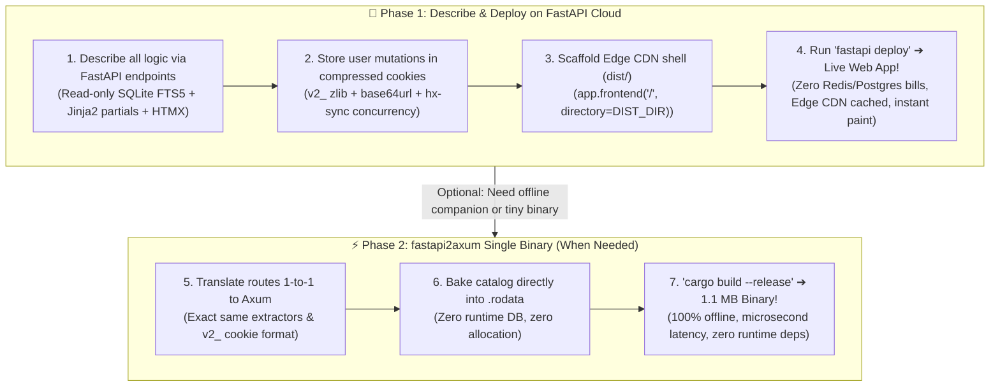

<div align="center">
  <h1>⚡ Thin Viewport Boilerplate</h1>
  <p><strong>The "Old-is-New" Architecture for Modern Web Apps &amp; Internal Tools</strong></p>
  <p><em>Zero Live Databases • Stateless Compressed Cookies • Edge-Cached SSR • Python (FastAPI) ➔ Rust (Axum)</em></p>
  <p>
    
    
    
    
    
  </p>
</div>

---

## 🏛️ The Architectural Manifesto

For the last decade, web development pushed business logic into giant JavaScript client-side bundles (React, Vue, SPAs), while backend deployments required maintaining separate database clusters (Postgres, Redis, MongoDB) with connection pools, migration pipelines, and server-side session management.

**Thin Viewport Boilerplate inverts this paradigm back to what is simple, robust, and lightning-fast:**

```mermaid
flowchart LR
    Client["<b>Client Browser</b><br/>(Dumb Viewport + HTMX)<br/><code>hx-sync='this:queue'</code>"]
    <-->|"Compressed Cookie<br/><code>v2_ (zlib + base64url)</code>"|
    Worker["<b>Ephemeral Worker</b><br/>FastAPI / Axum<br/>(Stateless • Zero DB Writes)"]
    -->|"Read-Only Index<br/>(FTS5 / .rodata)"|
    Catalog[("<b>Baked Catalog</b><br/>Zero Locks • Read-Only")]
```

1. **The Browser is Just a Viewport:** No heavy frontend framework. The browser renders clean HTML partials via **HTMX** and swaps them into the DOM.
2. **Zero Runtime Database Locks:** The application catalog, search index, and domain rules are baked ahead-of-time directly into read-only storage (SQLite FTS5 in Python, embedded `.rodata` in Rust). Server workers perform zero writes at runtime, completely dodging `SQLITE_BUSY` lock contention and costly managed database bills.
3. **Stateless Compressed Cookies:** Mutable user state is serialized into an HTTP-only cookie using `v2_` binary `zlib` (level 9) + unpadded `base64url`. Over 50 items fit into ~200 bytes—well below the browser 4 KB limit. Any cold cloud container can wake up and serve any request with zero cross-talk.
4. **Concurrency Serialization (`hx-sync`):** Single-tab mutation controls are strictly serialized with `hx-sync="this:queue"`. In-flight mutations never overwrite each other (dodging Read-Modify-Write / Lost Update race conditions).
5. **Dual-Stack Portability:** Prototype and iterate your application in Python (**FastAPI + Jinja2**), then convert to Rust (**Axum**) with near-identical routing ergonomics to compile into a single, self-contained `~1.5 MB` binary that executes in **microseconds**.

---

## 🗺️ The Two-Phase Developer Workflow



### 🚀 Phase 1: Describe & Deploy on FastAPI Cloud
1. **Describe all logic via FastAPI endpoints:** Build your app using standard Python functions, Jinja2 partials, and HTMX. No React build step, no client-side state managers.
2. **Stateless Compressed Cookies (`v2_`):** User state lives in compressed HTTP-only cookies. Any ephemeral FastAPI Cloud container can wake up cold and serve requests with zero server-side database lookups.
3. **Scaffold for FastAPI Cloud:** Serve the static shell from Edge CDN (`app.frontend("/", directory=DIST_DIR)`) with local bundled HTMX and precompiled CSS.
4. **Deploy & Enjoy:** Run `fastapi deploy` and get an instant, globally distributed, zero-maintenance web app.

### ⚡ Phase 2: `fastapi2axum` ➔ Single-Binary Offline App *(When Needed)*
Need to ship an offline desktop tool, a second-screen gaming companion, or a microsecond edge worker without forcing users to install Python or Docker?
1. **1-to-1 Translation:** Map your FastAPI endpoints to Axum handlers using our [side-by-side translation cheat sheet](#-the-fastapi--axum-conversion-playbook).
2. **Compile to Standalone Binary:** Run `cargo build --release` to produce a single **1.1 MB** binary.
3. **Microsecond Performance:** Achieves **6.85 µs** request latency (`146,000 req/s`) with zero external database processes.
4. **Complete Interoperability:** Because both phases share the exact same `v2_` cookie codec and JSON export format, users can effortlessly sync between the Phase 1 web app and Phase 2 offline app!

---

## 🛡️ Demo Showcase: Config & Policy Rule Builder

This starter repository includes a complete, production-grade DevOps **Policy Rule Builder**:
* **Catalog:** 16 pre-indexed security and deployment policies across *Network*, *Identity*, *Compute*, *Storage*, and *Compliance*.
* **Full-Text Typeahead Search:** Fast prefix matching powered by SQLite FTS5 (`porter unicode61`) in Python, and zero-allocation in-RAM matching in Rust.
* **DAG Prerequisite Resolution:** Rules with prerequisites (e.g. *Strict TLS 1.3* requires *HTTPS Ingress Redirect*) automatically detect and warn when dependencies are missing.
* **Mutual Exclusivity Conflict Detection:** Policies that cannot coexist (e.g. *Zero-Trust Short-Lived Tokens* vs *Legacy Long-Lived API Keys*) trigger real-time conflict banners with one-click resolution.
* **Live Manifest Compilation:** Automatically generates a deployment-ready Kubernetes / Terraform `policy.yaml` manifest.
* **Portable JSON Snapshots:** Export and import `~1 KB` snapshots to sync state across devices with zero logins or accounts.

---

## 📁 Repository Structure

```
thin-viewport-boilerplate/
├── dist/                          # Static edge assets (Edge CDN cacheable)
│   ├── index.html                 # Static application shell (sub-15ms first paint)
│   └── assets/
│       ├── app.css                # Precompiled standalone CSS (zero runtime JIT)
│       └── htmx.min.js            # Bundled local HTMX
│
├── python/                        # Reference Implementation (FastAPI)
│   ├── main.py                    # FastAPI server, cookie codec, HTMX endpoints
│   ├── policy_engine.py           # DAG unroller, conflict detector & manifest compiler
│   ├── seed_rules.py              # SQLite schema & FTS5 search index builder
│   ├── test_suite.py              # Integration test verifying the full pipeline
│   ├── pyproject.toml             # uv / pip configuration
│   ├── policies.db                # Read-only SQLite FTS5 catalog
│   └── templates/                 # Jinja2 SSR templates & partials
│       ├── index.html
│       └── partials/
│           ├── workspace.html     # Dynamic HTMX workspace state
│           └── search_results.html
│
└── rust/                          # Production Single-Binary Port (Axum)
    ├── Cargo.toml                 # Axum, Tokio, Flate2, Base64, Serde
    └── src/
        ├── main.rs                # Axum HTTP routes & CLI benchmarks
        ├── catalog.rs             # Embedded 16 policies in .rodata
        ├── policy_engine.rs       # Pure-Rust DAG compiler & collision detector
        ├── session.rs             # v2_ zlib + base64url cookie codec (Python parity)
        └── views.rs               # Zero-allocation server-rendered HTML
```

---

## 🚀 Quick Start

### Option A: Python (FastAPI + HTMX)

```bash
cd python

# Install dependencies (uv / pip)
uv sync

# (Optional) Rebuild read-only SQLite catalog
python seed_rules.py

# Run test suite
python test_suite.py

# Start local development server
uv run fastapi dev main.py
# -> Open http://127.0.0.1:8000
```

### Option B: Rust (Axum Single-Binary)

```bash
cd rust

# Run micro-benchmarks
cargo run --release -- --bench

# Run local production server
cargo run --release
# -> Open http://127.0.0.1:8080
```

---

## 📊 Performance & Execution Benchmarks

Benchmarked on Apple Silicon (M-series, release mode):

| Benchmark Metric | Python (FastAPI + SQLite FTS5) | Rust (Axum + Embedded `.rodata`) | Speedup |
| :--- | :---: | :---: | :---: |
| **Catalog Search** (`q=TLS`) | ~120 µs | **2.96 µs** | **40× faster** (337,000 ops/s) |
| **DAG Solve + SSR HTML Render** | ~480 µs | **6.85 µs** | **70× faster** (146,000 req/s) |
| **`v2_` Cookie Encode/Decode** | ~85 µs | **11.86 µs** | **7× faster** (84,000 ops/s) |
| **Binary / Artifact Size** | ~45 MB (Python runtime) | **1.1 MB (Single executable)** | **40× smaller** |
| **External Database Services** | **0** | **0** | **Zero cost** |

---

## 🔄 The FastAPI ➔ Axum Conversion Playbook

The core philosophy of this boilerplate is **rapid iteration in Python, followed by zero-effort conversion to a standalone Rust binary**.

FastAPI and Axum are architectural siblings: both use declarative routing, type-safe request extractors, and composable middleware. When you design a stateless app, the conversion is practically a 1-to-1 translation.

### Side-by-Side Translation Reference

| Concern | Python (FastAPI + Starlette) | Rust (Axum + Tokio) |
| :--- | :--- | :--- |
| **Route Mapping** | `@app.get("/workspace")`<br/>`@app.post("/policy/toggle")` | `.route("/workspace", get(workspace_handler))`<br/>`.route("/policy/toggle", post(toggle_policy_handler))` |
| **Form Data Extraction** | `async def toggle(policy_id: str = Form(...))` | `async def toggle(Form(form): Form<PolicyForm>)` |
| **Query Parameters** | `async def search(q: str = "")` | `async def search(Query(query): Query<SearchQuery>)` |
| **Cookie Reading** | `raw = request.cookies.get("tv_policies")`<br/>`policies = decode_policy_cookie(raw)` | `let policies = extract_policies_from_headers(&headers);` |
| **Set-Cookie Header** | `response.set_cookie(key="tv_policies", value=val)` | `res.headers_mut().insert(SET_COOKIE, val);` |
| **HTMX Event Trigger** | `response.headers["HX-Trigger"] = "refreshSearch"` | `res.headers_mut().insert("HX-Trigger", HeaderValue::from_static("refreshSearch"));` |
| **Cache Invalidation** | `headers=NO_CACHE_HEADERS` | `apply_no_cache(&mut res)` |
| **SSR Template Rendering** | `templates.TemplateResponse("workspace.html", ctx)` | `render_workspace(&mut html, &plan)` *(Zero allocation)* |
| **Catalog Storage** | Read-Only SQLite FTS5 (`policies.db`) | Embedded static slice in `.rodata` (`CATALOG`) |

### When to Use Which?

* **Use Python (FastAPI) during Phase 1:**
  * Instant hot-reloading (`uv run fastapi dev main.py`)
  * Rapidly iterate on your data models, DAG rules, and HTMX partial swaps
  * Zero compile cycles while discovering user requirements
* **Convert to Rust (Axum) for Phase 2 / Standalone Release:**
  * Need to distribute a single **1.1 MB** binary to users who don't have Python installed
  * Need microsecond request latency (`~6.85 µs`)
  * Need an offline-first companion desktop app or tiny edge container with near-zero RAM footprint
  * Both stacks use the **exact same `v2_` cookie and JSON export format**, so users can seamlessly switch back and forth!

---

## 💡 Key Architectural Patterns

### 1. The `v2_` Stateless Cookie Codec
Instead of storing state in Redis or Postgres, state is serialized into an HTTP-only cookie using zlib compression and URL-safe Base64:
```python
# python/main.py
def encode_policy_cookie(policies: list[str]) -> str:
    text = "\n".join(policies)
    compressed = zlib.compress(text.encode("utf-8"), level=9)
    b64 = base64.urlsafe_b64encode(compressed).decode("ascii").rstrip("=")
    return f"v2_{b64}"
```
* **Security Guardrail:** All decompression is bounded by `MAX_DECOMPRESSED_COOKIE_BYTES = 65536` to mathematically eliminate decompression bombs.

### 2. Concurrency Serialization (`hx-sync`)
Stateless cookies can suffer from Read-Modify-Write race conditions if a user fires two requests simultaneously in the same browser tab. Adding `hx-sync` to the `<body>` element serializes mutations into an in-flight queue:
```html
<body hx-sync="this:queue">
```
Every queued request waits for the previous response to arrive, ensuring it always transmits the freshest cookie header.

### 3. Read-Only SQLite with Zero Locks
SQLite databases are baked into the container image and opened strictly in read-only URI mode:
```python
conn = sqlite3.connect("file:policies.db?mode=ro", uri=True)
```
Because no transaction ever writes to disk at runtime, write-lock contention (`SQLITE_BUSY`) is physically impossible.

---

## 🤝 Acknowledgments & Community Credits

Special thanks to engineers from [r/FastAPI](https://www.reddit.com/r/FastAPI/) whose real-world architectural feedback shaped these patterns:
* **u/pvnimaxin** — for identifying Python `SimpleCookie` octal escaping bloat (`\054`), guiding the `v2_` binary compression design, and advising on bounded decompression limits and cache-busting headers.
* **u/DismalCockroach1928** — for analyzing in-flight asynchronous mutation edge cases and proposing `hx-sync="this:queue"` to serialize client-side mutations.

---

## 📜 License

Released under the [MIT License](LICENSE). Build whatever you want with it!
